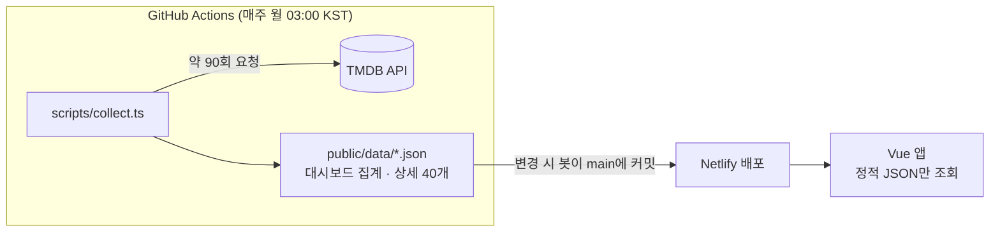

# TMDB 영화 데이터 대시보드

TMDB 데이터를 매주 수집·집계해 **국내 극장 개봉 추이, 장르 분포, 주간 트렌딩**을 보여주는 Vue 3 대시보드입니다.

**[배포 사이트 바로가기 →](https://sjkang-vue3-portfolio.netlify.app/)**

## 주요 기능

- **요약 카드**: 올해 국내 개봉작(전년 같은 기간 대비), 이번 달 개봉작(전월 대비), 다음 달 개봉 예정작
- **월별 개봉 추이**: 올해와 작년 비교. 기준일 이후는 등록된 예정작만 반영되므로 점선으로 구분
- **주간 트렌딩 TOP 10**: 인기도 순 가로 막대. 막대를 누르면 상세 페이지로 이동
- **장르 분포 TOP 10**: 올해 개봉작의 장르별 편수
- **트렌딩 / 상세**: 주간 트렌딩 영화·TV 캐러셀과 작품 상세
- **다크 / 라이트 모드**: 의미 기반 색상 토큰으로 두 모드를 하나의 스타일로 관리

## 기술 스택

| 구분          | 사용 기술                                                     |
| ------------- | ------------------------------------------------------------- |
| Frontend      | Vue 3 (`<script setup>`, TypeScript), Vite, Vue Router, Pinia |
| UI · 차트     | Quasar 2, ECharts 5 (tree-shaking)                            |
| 데이터 수집   | Node.js 스크립트 (tsx), GitHub Actions (cron)                 |
| 테스트 · 품질 | Vitest, vue-tsc, ESLint + oxlint, Prettier                    |
| 배포          | Netlify                                                       |

## 아키텍처



- 앱은 **TMDB를 직접 호출하지 않습니다.** 집계는 수집 단계에서 끝내고, 브라우저는 `dashboard.json` 하나만 받습니다.
- TMDB 토큰은 GitHub Actions secret에만 있고 클라이언트 번들에는 포함되지 않습니다.
- `src/api/tmdb`(API 클라이언트·타입·매퍼)는 브라우저 API에 의존하지 않도록 작성해, 수집 스크립트(Node)에서 그대로 재사용합니다.
- 수집 결과가 매주 커밋되므로 데이터 변화 이력이 git에 남습니다.

## 개선 과정

처음에는 브라우저가 TMDB를 직접 호출하는 구조였습니다. 차트가 늘어날수록 호출이 늘어나 느려졌고, 장르 분포·히트맵 차트는 결국 삭제했습니다. 이 문제를 구조부터 다시 설계했습니다.

### 1. API 호출 구조

|                        | Before                           | After                                               |
| ---------------------- | -------------------------------- | --------------------------------------------------- |
| 메인 진입 시 TMDB 요청 | **15회** (그중 12회는 순차 대기) | **0회** (정적 JSON 1회, 페이지 이동 시 재요청 없음) |
| API 토큰               | `VITE_` 환경 변수로 번들에 노출  | 번들에서 제거 (빌드 결과물에서 확인)                |
| 차트 추가 비용         | 차트마다 요청 N회 증가           | 수집 단계에서만 증가, 화면 성능 영향 없음           |
| 삭제했던 장르 차트     | 느려서 삭제                      | 수집 단계 집계로 복원                               |

### 2. 데이터 정확성

실제 API 응답을 검증하면서 숫자가 잘못 나오던 문제를 찾아 고쳤습니다.

- **지역 필터 무시**: `primary_release_date`와 함께 쓰면 `region=KR`이 무시되어 전 세계 등록 영화 수가 집계되고 있었습니다 (1월만 4,396편). `release_date` + `region` + 극장 개봉 타입으로 바꿔 국내 극장 개봉 기준(1월 65편)으로 수정했습니다.
- **집계 상한**: discover API의 `total_results`는 20,001에서 잘립니다. 전 세계 기준 연간 개봉 수(월별 합계 약 55,000편)가 20,001로 잘려 연간 비교가 의미 없었습니다. 국내 극장 개봉 기준(연 약 750편)으로 바꾸면서 함께 해결했습니다.
- **기간 비교**: "올해 전체 vs 작년 전체"는 연말 전에는 항상 감소로 보입니다. 연초부터 기준일까지를 전년 같은 기간과 비교하도록 바꿨습니다.
- **날짜 밀림**: `toISOString()`이 UTC로 변환해 한국 시간 기준 날짜가 하루씩 밀리던 문제를 수정했습니다.

### 3. UX

- 전체 화면 스피너 대신 카드·차트 단위 **스켈레톤**, 실패 시 **다시 시도**
- 확정치가 아닌 미래 구간은 점선, 비교할 수 없는 값은 증감률 대신 설명 표시
- 차트 색은 강조색 + 회색 방식으로 핵심 값만 강조하고, 배경 대비와 색각 이상 시뮬레이션으로 검증
- 다크 / 라이트 색상을 의미 기반 토큰(`--bg`, `--surface`, `--text-primary` …)으로 통합해 페이지별 중복 스타일 제거
- 지정한 폰트명이 실제 폰트 파일과 달라 Pretendard가 적용되지 않던 문제 수정
- 트렌딩 캐러셀 전환 시 이미지 로딩 전 높이가 0이 되어 깜빡이던 문제 수정 (521px → 93px → 521px로 흔들리던 높이를 고정)

## 데이터 기준

| 항목                | 기준                                                            |
| ------------------- | --------------------------------------------------------------- |
| 국내 개봉작         | TMDB에 등록된 한국 극장 개봉일(제한·일반 개봉) 기준             |
| 기준일              | 데이터를 수집한 날(KST). 화면의 "올해 / 이번 달"은 이 날짜 기준 |
| 다음 달 개봉 예정작 | 수집 시점에 등록된 예정작만 포함되어 확정치가 아님              |
| 장르 분포           | 한 작품이 여러 장르에 속하면 각 장르에 모두 집계                |
| 트렌딩              | TMDB 주간 트렌딩 (`trending/week`)                              |

## 시작하기

```sh
npm install
npm run dev
```

`public/data`에 수집된 데이터가 커밋되어 있어 **API 토큰 없이도 바로 실행**됩니다.

데이터를 직접 수집하려면 [TMDB API Read Access Token](https://developer.themoviedb.org/docs/getting-started)을 `.env`에 넣고 실행합니다.

```sh
# .env
TMDB_TOKEN=발급받은_토큰
```

```sh
npm run collect   # public/data/*.json 갱신
```

| 명령어              | 설명                      |
| ------------------- | ------------------------- |
| `npm run dev`       | 개발 서버                 |
| `npm run build`     | 타입 체크 + 프로덕션 빌드 |
| `npm run collect`   | TMDB 데이터 수집          |
| `npm run test:unit` | 단위 테스트 (Vitest)      |
| `npm run lint`      | oxlint + ESLint           |

### 자동 수집 설정

[`.github/workflows/collect-data.yml`](.github/workflows/collect-data.yml)이 매주 월요일 03:00(KST)에 수집하고, 데이터가 바뀌면 main에 커밋합니다. Netlify는 main 커밋을 감지해 다시 배포합니다.

1. 저장소 **Settings → Secrets and variables → Actions**에 `TMDB_TOKEN` 등록
2. 즉시 수집이 필요하면 **Actions → Collect TMDB data → Run workflow**

## 프로젝트 구조

```
scripts/collect.ts       TMDB 수집 → public/data 생성
public/data/             수집 결과 (봇이 커밋)
src/
  api/
    tmdb/                TMDB 클라이언트 · 응답 타입 · 매퍼 (수집 스크립트 전용)
    data/                정적 JSON 스키마 · 조회 함수 (앱 전용)
  config/                차트 색상 · 차트 옵션 생성 · ECharts 테마
  stores/                Pinia (대시보드 데이터, 테마)
  utils/                 날짜 · 통계 · 비동기 유틸 (단위 테스트 대상)
  views/pages/           Main · Trending · Detail
  assets/styles/         SCSS (theme.scss에 색상 · 타이포그래피 토큰)
```

## 테스트

날짜 계산, 증감률·월별 집계, 동시 요청 제한, TMDB 응답 매핑, 차트 옵션 생성, HTML 이스케이프 등 순수 함수를 Vitest로 테스트합니다 (29개).

```sh
npx vitest run
```

## 출처

This product uses the [TMDB](https://www.themoviedb.org/) API but is not endorsed or certified by TMDB.
